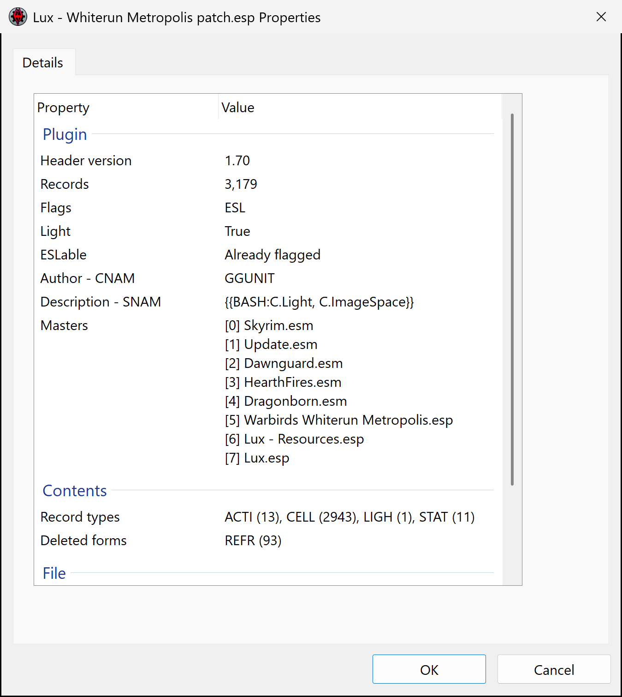

# Plugin Shell Extension

A Windows Explorer extension for Skyrim Special Edition plugins (`.esp`,
`.esm`, `.esl`). Right-click a plugin and choose **Plugin properties** to see
what is inside it, in a window styled after the Windows Properties >
**Details** tab. The same facts can also be shown as Explorer columns.



It only reads plugins; it never changes them.

## Download

Get `PluginShellExtension-<version>-setup.exe` from the
[latest release](https://github.com/cecell/plugin-shell-extension/releases/latest).

Requires Windows 10 or 11, 64-bit.

## The Plugin properties window

| Property | Shows |
|---|---|
| Header version | the `HEDR` version, e.g. `1.70` or `1.71` |
| Records | the `HEDR` record count (records plus groups, as the Creation Kit writes it) |
| Flags | the header flags that are set: `ESM`, `ESL`, `Localized` |
| Light | True if the game loads the plugin as light (`.esl` file, or the ESL flag) |
| ESLable | what it takes to make the plugin light, see [ESLable](#eslable) ("Already flagged" for light plugins) |
| Author - CNAM | the author field, wrapped |
| Description - SNAM | the description field, wrapped, line breaks kept |
| Masters | one per line as `[index] name`; the index is the FormID prefix that refers to that master |
| Record types | each top-level group with its record count, alphabetical: `CELL (2943), STAT (11), ...`. A group's count includes everything nested in it, so `CELL` includes its placed references and `DIAL` its `INFO`s |
| Deleted forms | deleted placed objects and navmeshes by type, `REFR (93), NAVM (5)`, or "None". These are the types xEdit's Quick Auto Clean deals with (`REFR`, `ACHR`, `PGRE`, `PMIS`, `PARW`, `PBAR`, `PBEA`, `PCON`, `PFLA`, `PHZD`) plus `NAVM` |
| Size, Created, Modified, Attributes | formatted exactly as Windows' own Details tab shows them |

The header fields appear at once. Record types, Deleted forms and ESLable need
a pass over every record, which runs in the background and fills in a moment
later (Skyrim.esm, 250 MB, takes about a second).

Right-click a row to copy its value or the whole table. The Property column
and the window can be resized.

The window follows the Windows light/dark app mode (Settings >
Personalization > Colors), switching live when it changes, and uses the
high-contrast colours when high contrast is on. It scales for the display it
is on, including when dragged to a monitor with a different scale.

### ESLable

| Value | Meaning |
|---|---|
| Already | already light (ESL flag or `.esl`); the window says "Already flagged" |
| True | can be ESL-flagged as it is: header below 1.71 with up to 2,048 new records, all in `800`-`FFF`, or header 1.71 or later with up to 4,096 new records, all in `000`-`FFF`. A plugin with no new records (overrides only) is True |
| Save in CK | header below 1.71, all new records in `000`-`FFF` but not within the old limits (IDs below `800`, or 2,049-4,096 of them). Resaving it in the newer Creation Kit gives it a 1.71 header, after which it fits |
| False | anything else. This includes plugins that could only be made light by renumbering (compacting) their FormIDs, an advanced step this tool does not suggest |
| Corrupted | the file could not be read to the end |

"New records" are the plugin's own records, not its overrides of master
records. When a True or Save in CK result relies on IDs below `800`, the window
(ESLable row tooltip), the file tooltip and the details pane add **Requires
v1.6.1130 or later**: older game versions cannot load such plugins as light.

## Explorer columns, details pane and tooltip

The setup option **Add columns to Explorer, the details pane and files
tooltip** (on by default) makes these fields available in Explorer:

| Column | Value |
|---|---|
| Header Ver | the header version, e.g. `1.71` |
| #Records | the header record count (sorts as a number) |
| Flags | `ESM, ESL, Localized` |
| Is Light | True / False |
| #Masters | number of masters |
| #Deleted | the Deleted forms total, a hint that the plugin may need cleaning; blank when there are none |
| ESLable | Already, True, Save in CK, False or Corrupted, as above |

Turn the columns on in Details view: right-click a column header > **More...**.
The details pane (Alt+Shift+P) shows all of them plus the masters, and the
tooltip when hovering a plugin shows #Records, the masters and, when it
applies, the ESLable note.

#Deleted and ESLable fill in after the other columns, because they need the
pass over every record. Results are remembered per Explorer session, so
refreshing a folder does not scan the plugins again.

Windows only accepts these properties registered for the whole machine, so
this option asks for administrator rights once. The rest of the extension is
installed for your user only. Restart Explorer after installing so it picks up
the columns.

## Install and uninstall

Run the setup. It opens on the GPL-3.0 licence, which has to be accepted,
installs for the current user into
`%LOCALAPPDATA%\Programs\Plugin Shell Extension` without an admin prompt
(apart from the optional columns), and offers to open this README at the end.

On Windows 11 the menu item is in the classic menu: right-click > **Show more
options**, or Shift+right-click.

To update, run the newer setup; it works while Explorer still has the old
version loaded. Restart Explorer or sign out afterwards to use the new one.

To uninstall, use Settings > Apps > Installed apps > **Plugin Shell
Extension**.

Silent install and uninstall use the usual Inno Setup switches:
`PluginShellExtension-<version>-setup.exe /VERYSILENT`, and
`unins000.exe /VERYSILENT` in the install folder.

Pre-release builds before 0.90 used a different name. If one is installed,
setup asks you to uninstall it first, because both use the same registry keys.

Run setup from Explorer or a normal terminal. Started from inside a packaged
(MSIX) app, such as some app-integrated terminals, its registry writes go to
that app's private copy of the registry, and the menu item never appears in
Explorer.

## Verifying a download

Release files are built by GitHub Actions
([`.github/workflows/build.yml`](.github/workflows/build.yml)) on a clean
Windows runner, not on a personal PC:

- the compiler is pinned to MSVC 14.44, and its exact version is in the log
- Inno Setup 7.1.1 is downloaded from its official release and checked
  against a pinned SHA-256 before use
- every run publishes `SHA256SUMS.txt` for the DLL and the installer, in the
  run summary and in its downloadable artifact
- a release attaches one run's files unchanged, so they are byte for byte the
  files that run hashed; the release notes link the run and the VirusTotal
  reports
- runs since the repository became public also attach signed build
  provenance, which ties each file's hash to the commit and the run:

```
gh attestation verify PluginShellExtension-<version>-setup.exe --repo cecell/plugin-shell-extension
```

0.90 was built while the repository was still private, so it has no
provenance attestation. Its run log and artifact are public and carry the same
SHA-256 values as the release.

To check a file yourself: `sha256sum -c SHA256SUMS.txt`, or `Get-FileHash
<file>` in PowerShell. A local build will not reproduce the official hashes,
because the linker stamps build times into the files.

## Licence and disclaimer

GPL-3.0, see [LICENSE](LICENSE).

The software is provided "as is", without warranty of any kind, to the extent
permitted by applicable law. See sections 15 and 16 of the licence for the
full terms.

## Credits

The installer is built with [Inno Setup](https://jrsoftware.org/),
Copyright (C) Jordan Russell.

Plugin Shell Extension was written with the assistance of Claude by Anthropic.
Many have negative feelings towards AI but it has been a life saver for people
like me who struggle with cognitive disabilities. I hope this software is
helpful.

## Building from source

Requires Visual Studio with the MSVC 14.44 (v143) toolset; CMake and Ninja
come with Visual Studio. The installer needs Inno Setup 6.6 or newer
(`winget install JRSoftware.InnoSetup`); without it the build still produces
the DLL.

```
build.cmd
```

Outputs, in `build\`:

- `bin\PluginShellExtension.dll`: the extension (static CRT, no redistributable needed)
- `PluginShellExtension-<version>-setup.exe`: the installer
- `plugininfo.exe <plugin>...`: prints the same fields, plus a self-check that the records and groups walked add up to the header count
- `menutest.exe <plugin> [--invoke]`: builds Explorer's right-click menu for a file and checks the item is there (and opens)
- `proptest.exe <dll> <plugin>...`: loads the property handler from the DLL without registering it, feeds it a file the way Explorer does, and prints every column value

### Testing without installing

```
rundll32 build\bin\PluginShellExtension.dll,ShowProperties C:\path\to\Plugin.esp
rundll32 build\bin\PluginShellExtension.dll,Snapshot "C:\path\to\Plugin.esp" "C:\out.png"
```

`Snapshot` renders the window to a PNG once the scan finishes (`snap.sh` wraps
it). `regsvr32 build\bin\PluginShellExtension.dll` registers the build output
for the current user (`/u` to undo).

Debugging switches:

- `PSE_LOG=C:\some\file.log` in a process's environment, or the registry value
  `HKCU\Software\PluginShellExtension\LogFile`, traces the handler's calls
- an empty `load_trace.log` next to the DLL logs every process that loads it
- `PSE_THEME=dark` or `light` forces the theme, `PSE_DPI_UNAWARE=1` renders the
  100% layout, and `PSE_TEST_HIGHLIGHT=1` makes `Snapshot` show a selected
  and a hovered row

### Source layout

- `src/plugin_parser.*`: reads the plugin header and walks the groups (bounds-checked; reads files or Explorer's streams)
- `src/property_window.*`: the window and its Property/Value list (custom, because a ListView cannot give rows different heights)
- `src/context_menu.*`: the right-click menu handler
- `src/property_handler.*`: the Explorer property handler behind the columns, details pane and tooltip
- `src/registration.*`: registry layout for `regsvr32`; the installer writes the same keys
- `src/dllmain.cpp`: COM exports and the `rundll32` entry points
- `installer/PluginShellExtension.iss`: the Inno Setup installer
- `installer/PluginShellExtension.propdesc`: the property schema (names, labels, types, alignment)
- `installer/icon/`: the installer icon and its source image
- `tools/`: `plugininfo`, `menutest`, `proptest`
- `.github/workflows/build.yml`: the official build
